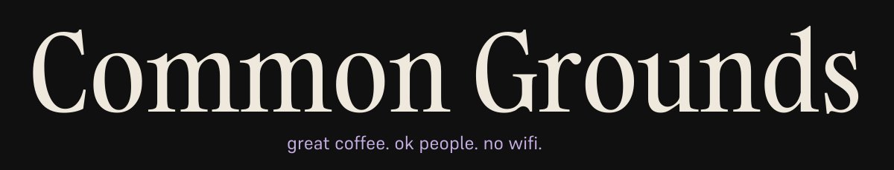
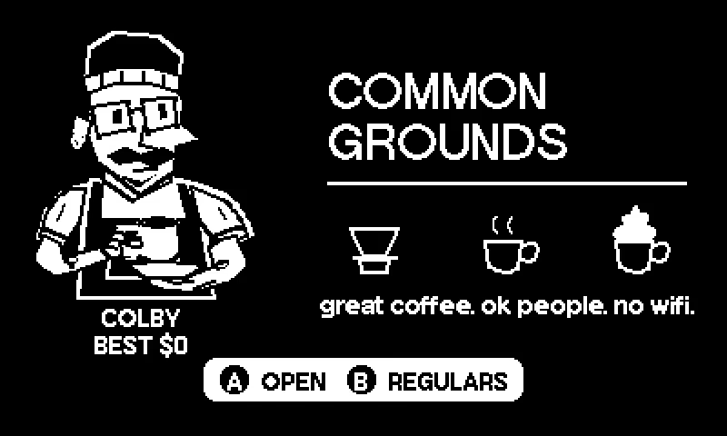

  

  

**Hold B. Turn the crank. Keep the regulars happy.**

A free coffee game for Playdate. Help Colby serve pour-overs, espresso and hot chocolate to twenty opinionated regulars. Good drinks fill the tip jar. Three complaints close the shop early.

   
  <!-- game-version -->v0.8.3 · build 2<!-- /game-version -->

---

  
  
  Follow <a href="https://help.play.date/games/sideloading/">Playdate’s official sideloading guide</a>
  
Read the <a href="CREDITS.md">Credits</a>

